# VMS（Unicorn）/ UG-I500 / UNV Guard 常见问题定位与信息收集方法

> 版本：V2026
> 适用产品：VMS（Unicorn）、UG-I500、UNV Guard
> 用途：SSH工具内置参考手册，指导一线技术支持快速定位问题并收集必要信息
>
> **流程图说明**：本文档中所有排查流程均使用 Mermaid 流程图呈现。若你的 SSH 工具不支持 Mermaid 渲染，可将 `.md` 文件放入支持 Mermaid 的 Markdown 查看器（VS Code、Typora、Obsidian、GitHub 等）查看。

---

## 目录

- [一、通用规范](#一通用规范)
  - [1.1 问题反馈规范](#11-问题反馈规范)
  - [1.2 信息收集注意事项](#12-信息收集注意事项)
- [二、VMS（Unicorn）](#二vmsunicorn)
  - [2.1 日志与报文收集方法](#21-日志与报文收集方法)
  - [2.2 设备管理类问题](#22-设备管理类问题)
  - [2.3 实况类问题](#23-实况类问题)
  - [2.4 录像回放与下载类问题](#24-录像回放与下载类问题)
  - [2.5 报警类问题](#25-报警类问题)
  - [2.6 界面异常及崩溃类问题](#26-界面异常及崩溃类问题)
- [三、UG-I500](#三ug-i500)
  - [3.1 日志与报文收集方法](#31-日志与报文收集方法)
  - [3.2 界面登录异常](#32-界面登录异常)
  - [3.3 设备管理类问题](#33-设备管理类问题)
  - [3.4 实况类问题](#34-实况类问题)
  - [3.5 录像回放与下载类问题](#35-录像回放与下载类问题)
  - [3.6 报警类问题](#36-报警类问题)
  - [3.7 界面操作报错类问题](#37-界面操作报错类问题)
- [四、UNV Guard](#四unv-guard)
  - [4.1 日志与报文收集方法](#41-日志与报文收集方法)
  - [4.2 界面登录异常](#42-界面登录异常)
  - [4.3 设备管理类问题](#43-设备管理类问题)
  - [4.4 实况类问题](#44-实况类问题)
  - [4.5 录像回放与下载类问题](#45-录像回放与下载类问题)
  - [4.6 报警类问题](#46-报警类问题)
  - [4.7 界面操作报错类问题](#47-界面操作报错类问题)

---

## 一、通用规范

### 1.1 问题反馈规范

为提升问题处理效率并避免因信息不全导致的重复沟通，请严格遵循以下规范提交问题反馈，确保关键信息一次性完整提供。

| 项目 | 说明与示例 |
|------|-----------|
| 项目/渠道名称 | XX项目 |
| 产品型号及版本补丁 | VMS: `VMS-B1101.21.33.C02314.230904`；UG-I500: `B1102.1.3.9.P17.260720`；UNV Guard: `B1102.1.3.9.P17.260720` |
| 组网拓扑 | 示例：`IPC-Onvif-NVR(192.168.7.6)-Private-VMS(192.168.6.90)-PC(192.168.0.99)`；UG/UNV Guard涉及相机需提供通道编码 |
| 问题描述 | 详细描述故障现象，说明是个例问题还是批量问题（如实况异常时是单个IPC实况异常，还是批量IPC实况异常） |
| 故障前操作 | 新开局/新配置即异常，或运行过程中异常，或做某些特殊操作/断电后出现异常 |
| 初步排查 | 已做的排查动作及结果，如：4画面实况，相机分辨率720P，在客户端解码能力内，异常时电脑CPU及内存占用正常 |
| 问题素材 | 配置截图/录屏、故障现象截图/录屏、故障的时间点、故障过程的报文与日志 |

### 1.2 信息收集注意事项

1. **务必保证所收集的日志与报文包含问题触发的时间点**
   - 日志：使用记事本或Notepad++打开，查看日志左侧的时间点列表看是否包含（VMS需要保证未重启，只要重启，重启前的日志就会被覆盖）
   - 抓包：电脑安装wireshark软件，使用wireshark打开pcap或pcapng格式的报文，查看报文时间点

2. **报文时间时区换算**：报文的时间会根据所打开电脑的时区自动切换，因此分析时需根据现场设备时区手动换算差值

3. **Wireshark时间格式**：首次安装wireshark，时间非常用格式显示，可以在 `【View > Time Display Format】` 调整时间显示格式

4. **小技巧**：web页面抓包时，可同时开启两个网页，一个页面抓包，一个页面复现问题，以保证抓包文件最小

---

## 二、VMS（Unicorn）

### 2.1 日志与报文收集方法

#### 2.1.1 诊断日志

- **导出路径**：VMS Web `【System > Maintenance > Maintenance】`，点击 "Export Diagnosis Info"
- **EZVMS客户端日志路径**：`C:\Users\Public\EZVMS\log`

#### 2.1.2 Debug日志（模块级详细日志）

诊断日志记录有限，Debug日志记录某些业务模块更加详细的日志。

**开启方法**：
1. 进入VMS Web `【System】` 界面
2. 同时按住 `Ctrl+Alt+Shift+Y` 进入隐藏界面
3. 点击 "Enhanced Features"，进入 `【Module Logs】`
4. 勾选需要的Module，点击 "Generate" 启动日志
5. 问题复现后导出诊断日志，debug日志会随诊断日志一起导出

> **注意**：涉及到宇视云的相关问题务必打开net模块的debug日志

#### 2.1.3 诊断日志路径修改方法（重启恢复类问题必做）

VMS诊断日志记录的信息会在重启之后被覆盖，故对于一些重启才能恢复正常的问题，直接依靠重启后导出的诊断日志无法定位，此时需要修改日志保存路径为 `/var/coredump`。

> **版本说明**：D028SP36之前的版本修改日志保存路径后仅第一次重启生效；该版本及以后版本重启后修改的日志保存路径依然会生效。

#### 2.1.4 普通抓包（Web界面）

**操作路径**：`【System > Maintenance > Packet Capture】`

1. 填写指定/过滤的端口/IP地址
2. 点击 "Create Task" 后点击界面下方创建抓包任务
3. 点击开始按钮开始抓包
4. 等待问题复现后点击停止按钮停止抓包

**抓包模式说明**：
- **Specify（指定）**：针对某个端口/IP地址抓包，报文中将只包含与该端口及IP地址的交互
- **Filter（过滤）**：不抓与某个端口/IP地址，报文中将没有与该端口/IP交互，只有与其他端口/IP的交互
- **默认参数（ALL）**：抓全包

#### 2.1.5 后台抓包（SSH + tcpdump）

由于界面抓包有大小限制，当遇到报文大小可能会超过80M的情况（如批量实况、大量云设备注册等），则需要在SSH进入系统后台使用tcpdump命令进行抓包。

**tcpdump参数说明**：

| 参数 | 说明 |
|------|------|
| `-i` | 收集报文的网口，通常填写 `any` 表示抓取所有网口报文 |
| `-s` | 指定每个数据包的大小，不加默认抓取68字节，`0` 表示抓取所有长度的报文 |
| `port` | 指定监听端口，抓取与该端口交互的报文 |
| `or` / `and` | 逻辑"或"/"与"关系 |
| `host` | 指定监听主机IP，抓取与该IP地址交互的报文 |
| `-w` | 将获取的报文保存到文件中 |
| `-v` | 实时显示抓包过程和抓取的报文数量 |

**常用示例**：
```bash
# 抓所有网卡过滤554端口的报文
tcpdump -s 0 -i any not port 554 -w 0727baowen.pcap -v

# 抓VMS与相机与PC地址交互的报文
tcpdump -s 0 -i any host 172.1.0.2 or 172.1.90.161 -w 0727baowen.pcap -v

# 抓全包
tcpdump -s 0 -i any -w 0727baowen.pcap -v
```

**注意事项**：
- 需进入系统二级抓包
- 输入完命令后回车开始抓包，复现问题后执行 `Ctrl+C` 停止抓包
- 进入二级后默认执行在根目录（`/`）下，抓包文件也在该路径下生成，使用Mobaxterm软件下载
- 下载完后需手动在后台将该文件删掉，避免文件过大占用系统空间

#### 2.1.6 背景抓包（偶现/长时间复现问题）

应用于问题复现周期长的偶现问题。

**关键抓包语句**（tcpdump_begin.sh脚本中）：
```bash
# VMS-B180/B200/Unicorn
tcpdump -s 0 -i eth0 not port 554 -w $fileroot -C 200 -W 20 &

# 存储一体机（IPSAN）
tcpdump -s 0 -i eth0 not port 554 -w vms5.pcap -B 102400 -C 200 -W 20 -Z root &
```

**脚本使用方法**：
1. 将脚本导入VMS后，执行 `sh tcpdump_begin.sh` 开始抓包
2. 问题复现后，执行 `sh kill_tcpdump.sh` 停止抓包

**文件生成目录**：
- VMS(Unicorn)抓包脚本过滤554端口：报文生成在 `/var/coredump/cwt/` 目录下
- 存储一体机过滤554端口：报文生成在脚本所在目录

**注意事项**：
- 尽可能在问题复现时第一时间停止抓包、导出报文，避免时间过长导致报文被覆盖
- 上述方法执行后重启会中断抓包，若想重启后仍保持抓包需参考专门文档
- 可根据实际需要修改：红色标识部分按实际抓包网口修改（如eth1）；蓝色部分按实际抓包条件修改（如 `host x.x.x.x`）

---

### 2.2 设备管理类问题

#### 2.2.1 设备离线

**组网**：`IPC/NVR/LPR/门禁设备 - onvif/private/Rtsp - VMS - PC`

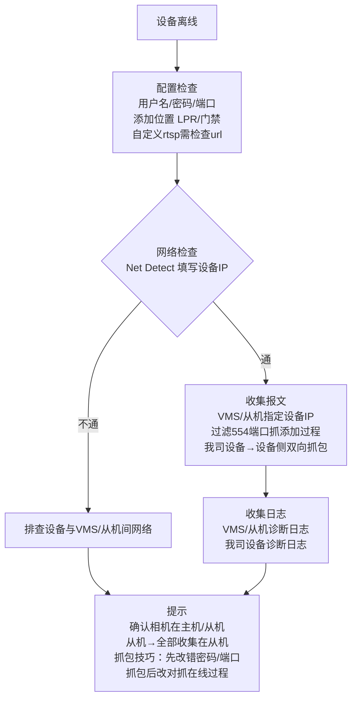

**要点**：
- 配置检查：用户名、密码、端口、设备添加位置（LPR、门禁）、自定义rtsp协议需检查url
- 网络检测入口：VMS/从机 Web `【System > Maintenance > Net Detect】`
- 抓包注册过程小技巧：可先在VMS侧将相机密码/端口修改错误使其离线，然后抓包修改正确使其在线的过程

#### 2.2.2 设备频繁上下线

**组网**：`IPC/NVR/LPR/门禁设备 - 私有/Onvif - VMS`

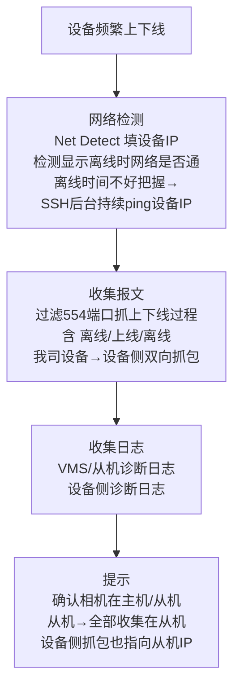

#### 2.2.3 宇视云相关问题

**现象1：宇视云账号离线**

- **组网**：`IPC/NVR/LPR/门禁设备 - 宇视云 - VMS`
- **网络**：`【System > Maintenance > Net Detect】`，填写宇视云域名地址，检测网络是否通
- **报文**：VMS针对添加云账号的过程抓包（VMS过滤554端口抓包）
- **日志**：抓包前开启net模块的debug日志，抓完包后导出VMS诊断日志

**现象2：宇视云账号在线，云设备在云账号上显示在线，在VMS web显示离线**

- **报文**：离线设备和VMS同时过滤554端口针对添加云账号的过程抓包（云账号在VMS显示在线1分钟后方可停止抓包，提供离线设备的SN号）
- **日志**：离线设备及VMS诊断日志（抓包前开启net模块的debug日志）

**不删除云账号的抓包方法**：
- 方法1（推荐）：在EZCloud web将云账号的密码修改错误，等待云账号在VMS侧显示离线后开始抓包，然后修改云账号的密码正确，在VMS Web "Cloud Account"对应云账号后面点击刷新，抓包云账号的注册过程
- 方法2：让设备在云账号显示离线，然后开启抓包，让设备在云账号显示在线，在VMS Web上点击刷新云账号

> **报文大小注意**：云设备注册过程的报文可能会超过界面大小限制，界面抓完包后确认报文时间是否覆盖添加操作的时间点，并过滤离线设备的SN号（`ip contains "210235C6HN3251000076"`），若时间未包含也过滤不到，则需要到系统后台使用tcpdump命令抓包。

**现象3：VMS web显示的云设备数量与云账号中的设备数量不一致，缺少部分云设备未同步**

- **检查**：检查缺少的云设备是否为该云账号上被共享的设备。被共享的设备需要在云账号上选择"角色共享"，VMS当前不支持"权限共享"
- **报文**：VMS过滤554端口针对添加云账号的过程抓包（云账号在VMS显示在线1分钟后方可停止抓包，提供缺失设备的SN号）
- **日志**：VMS诊断日志（抓包前开启net模块的debug日志）
- 不删除云账号的抓包方法同现象2

---

### 2.3 实况类问题

#### 2.3.1 卡顿/花屏/黑屏/报错（局域网组网）

**组网1**：`IPC/NVR/LPR/门禁设备 - 私有/Onvif/RTSP - VMS - PC`

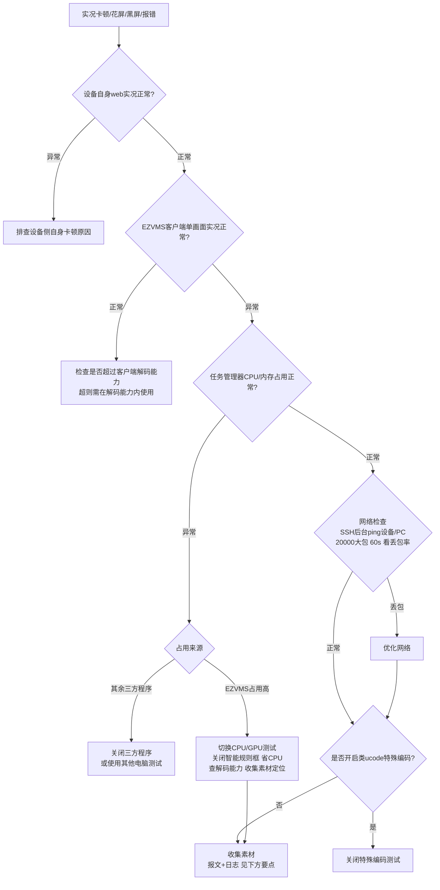

**收集素材要点**：
- **报文**：针对启动相机单画面实况的过程抓包（VMS/从机指定设备IP地址及PC IP地址；我司设备则在设备web页面针对VMS/从机IP地址抓包；PC同时使用wireshark在实况的电脑上抓包），提供设备、VMS/从机、PC IP地址
- **日志**：VMS/从机与设备侧诊断日志、EZVMS客户端日志
- EZVMS占用排查：①查看实况是否显示智能规则框，若显示可在EZVMS `【Client Configuration > Intelligent】` 关闭测试（界面开启智能规则会占用较多CPU）；②查看是否超过客户端解码能力，未超过则收集开始卡顿的实况路数、分辨率、码率、电脑DxDiag信息、EZVMS LOG定位
- 提前确认相机分配在主机还是从机，若是从机，所有收集均在从机进行

#### 2.3.2 卡顿/花屏/黑屏/报错（宇视云组网）

**组网2**：`IPC/NVR/LPR/门禁设备 - 宇视云 - VMS - PC`

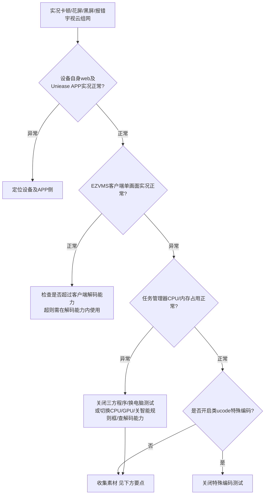

**收集素材要点**：
- **报文**：针对启动相机实况的过程抓包（VMS抓全包；我司设备则在设备web页面抓全包；PC同时使用wireshark在实况的电脑上抓包），提供设备SN号及PC IP地址
  - 注：若界面抓包过大未覆盖启动实况的时间点，则需后台SSH抓包
- **日志**：VMS（需要打开net模块的debug）与设备侧诊断日志、EZVMS客户端日志

#### 2.3.3 VMB-180人机界面卡顿/花屏

**组网3**：`IPC/NVR/LPR/门禁设备 - onvif/private/rtsp/宇视云 - VMS-B180`

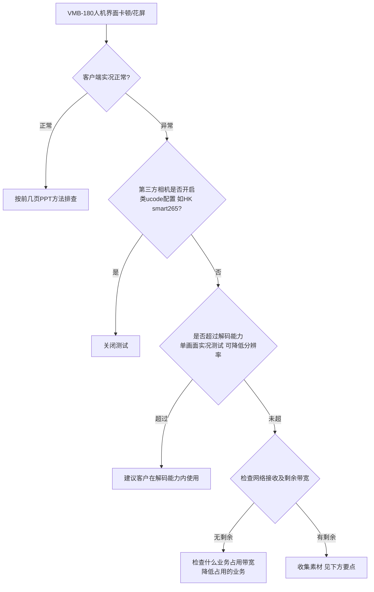

**收集素材要点**：
- **报文**：首先关闭所有客户端实况，web界面抓全包（抓该过程：人机界面单独启动一个卡顿相机的实况）
- **日志**：
  1. 诊断日志
  2. Ssh进入后台，取 `/var/logbackup/VmsClientlog/` 路径下的日志

---

### 2.4 录像回放与下载类问题

#### 2.4.1 回放卡顿/花屏（设备侧录像）

**组网1**：`IPC/NVR（设备侧录像） - Onvif/Private/rtsp/宇视云 - VMS - PC`

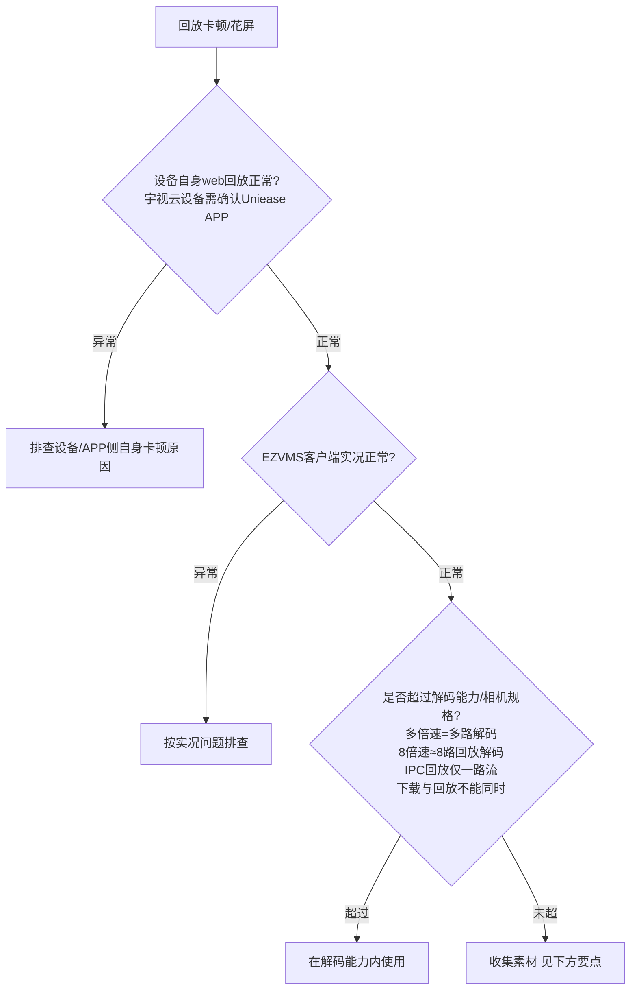

**收集素材要点**：
- **报文**：针对启动相机单画面回放的过程抓包（VMS/从机指定设备IP地址及PC IP地址；我司设备则在设备web页面针对VMS/从机IP地址抓包；PC同时使用wireshark在回放的电脑上抓包），提供设备、VMS/从机、PC IP地址
  - 局域网：提前确认相机分配在主机还是从机，若是从机，所有收集均在从机
  - 宇视云：抓包需要抓VMS全包，且VMS诊断日志需要打开net模块的debug
- **日志**：VMS/从机与设备侧诊断日志、EZVMS客户端日志

#### 2.4.2 回放卡顿/花屏（VMS主机/从机存储）

**组网2**：`IPC/NVR - Onvif/Private/rtsp/宇视云 - VMS（VMS主机/从机存储） - PC`

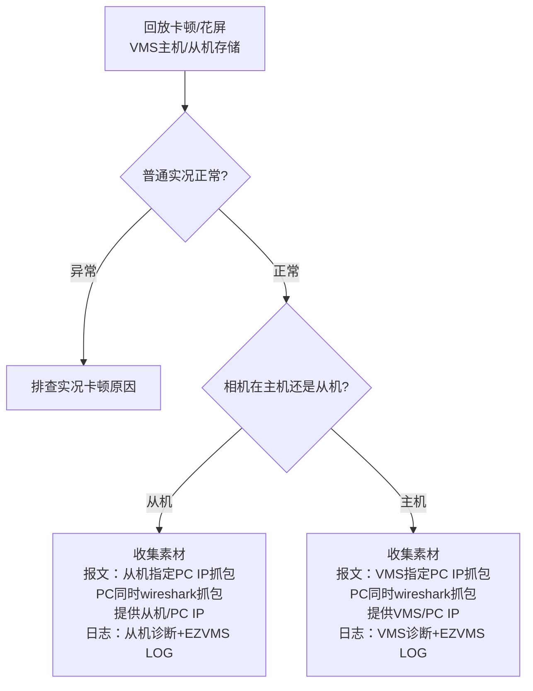

#### 2.4.3 回放检索无录像/录像断续（设备侧存储）

**组网1**：`IPC/NVR（录像存储于设备侧） - onvif/private/宇视云 - VMS - PC`

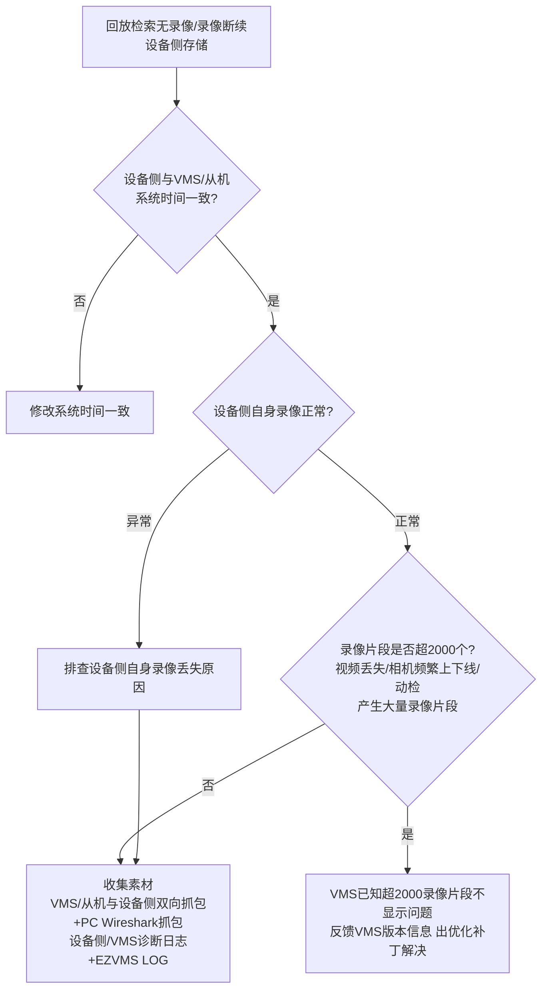

> 提前确认相机分配在主机还是从机，若是从机，所有收集均在从机。

#### 2.4.4 回放检索无录像/录像断续（VMS主机/从机存储）

**组网2**：`IPC/NVR - onvif/private/宇视云 - VMS（VMS主机/从机存储） - PC`

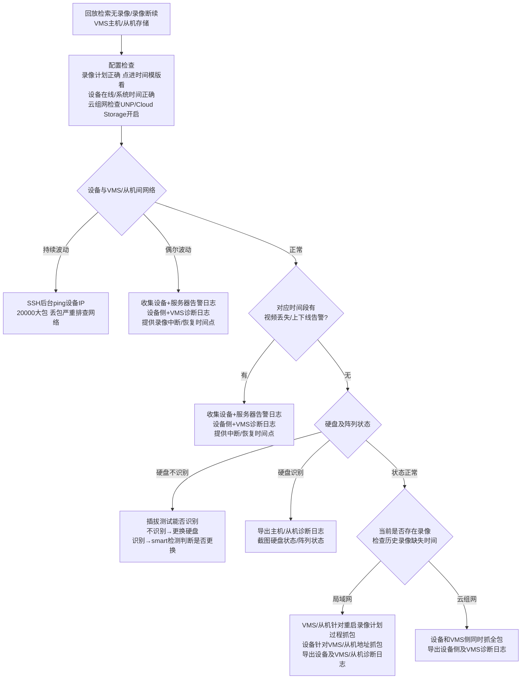

> 提前确认相机分配在主机还是从机，若是从机，系统时间/诊断日志/报文/检测网络均在从机收集。

#### 2.4.5 录像下载异常

**组网**：`IPC/NVR - onvif/private/宇视云 - VMS - PC`

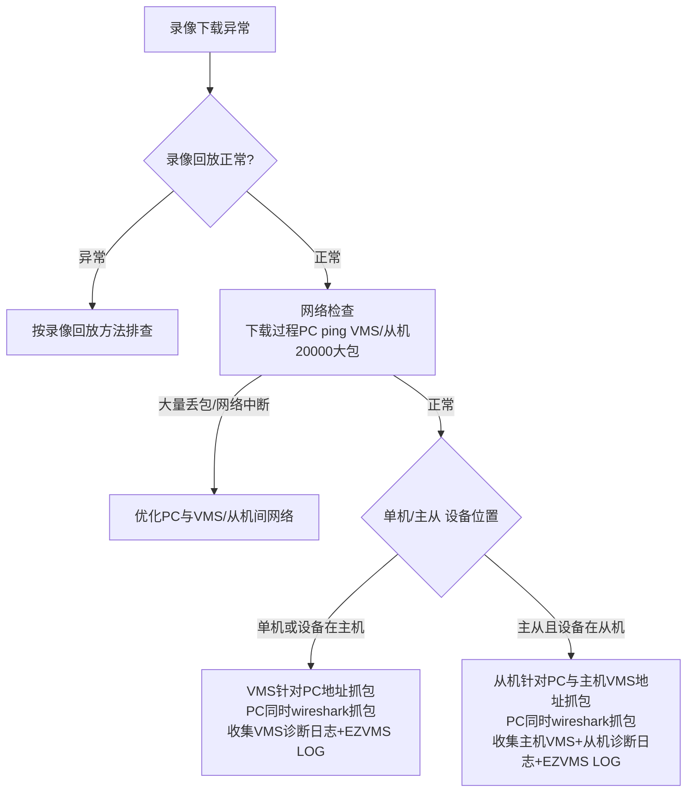

---

### 2.5 报警类问题

#### 2.5.1 无法收到设备告警

**组网**：`IPC/NVR - onvif/private/宇视云 - VMS - PC`

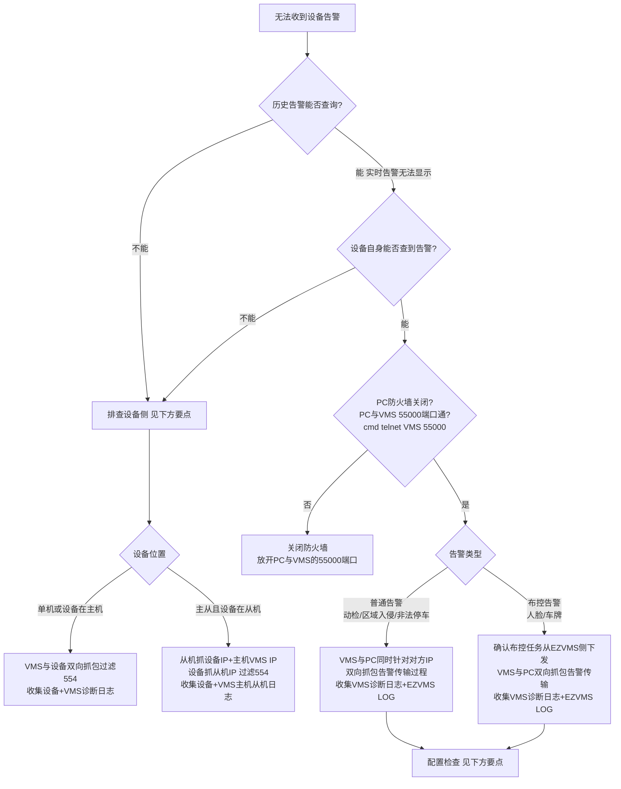

**要点**：
- 布控告警：人脸库/车牌库、人脸布控任务/车牌任务是否从EZVMS侧下发，若非则需要设备侧删除库与布控任务，由EZVMS侧重新下发
- 配置检查：
  - 智能识别、卡口监控、混行检测等功能是否在 `【Smart Device】` 添加
  - 槽位1是否有硬盘（存储告警图片），是否打开智能分区（打开客户端Data Search界面自动打开）
  - 是否有做告警订阅（客户端告警订阅、设备告警订阅），或配置了告警订阅但是"OFF"状态

---

### 2.6 界面异常及崩溃类问题

#### 2.6.1 Web界面卡住/登录异常/自动重启（重启恢复正常）

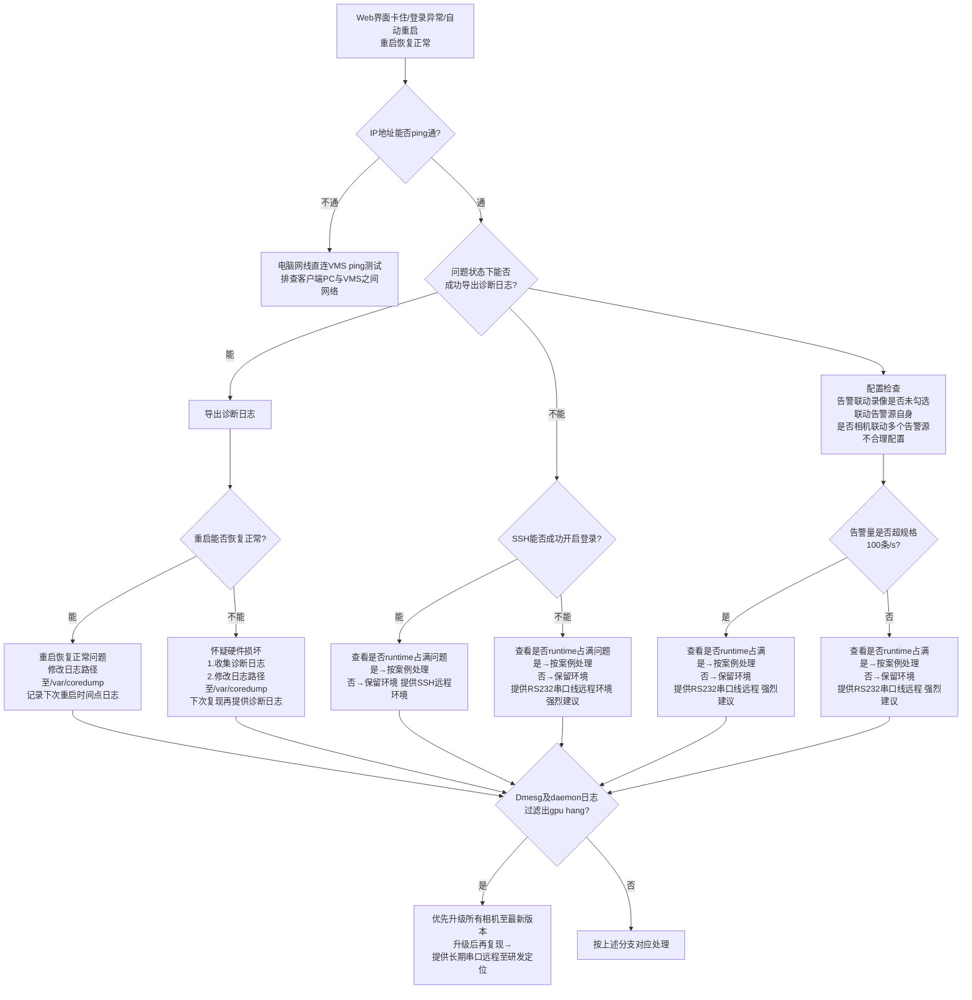

> **注意**：如是重启恢复正常问题，重启后收集的诊断日志时间日志已被覆盖，需修改日志路径至 `/var/coredump` 才能在下次重启后记录问题时间点日志。

#### 2.6.2 EZVMS客户端运行过程中崩溃

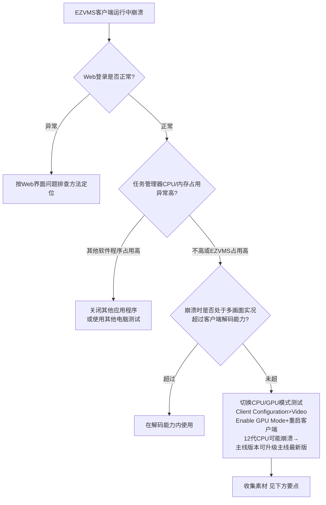

**收集素材要点**：
- EZVMS LOG
- EZVMS LOG同级目录如有生成dump文件，也同步收集
- 电脑的DxDiag信息
- 如客户端处于无响应状态，还需在任务管理器中收集EZVMS客户端的"转储文件EZVMS.DMP"

---

## 三、UG-I500

### 3.1 日志与报文收集方法

#### 3.1.1 UG诊断日志

- **导出路径**：进入 `【Operations & Maintenance > System Diagnosis > Server Diagnostic Info】`，选择Server及Server Time，点击 "Generate" 生成并导出日志
- **播放器控件日志**：记录媒体信息（实况、回放等），默认路径：客户端电脑 `C:\Surveillance\UPlayer_x64\log`

#### 3.1.2 IPSAN日志

**IPSAN诊断日志**：
- 登录IPSAN Web页面 `【Log > Diagnosis Log】` 界面，选择时间段，点击 "Export" 即可导出

**IPSAN的cdvsystemreport（UG配套软件的日志）**：
- SSH进入IPSAN后台（端口7777）
- 执行 `systemreport.sh vm /root` 命令收集
- 收集完后日志在 `/root` 目录下

#### 3.1.3 普通抓包

**方法1：UG-I500 web页面收集抓包（推荐）**
- 路径：UG web -> `【System Diagnosis】 -> 【Server Packet Capture】`
- 支持指定/过滤端口及IP抓包

**方法2：SSH后台抓包**
- ssh进入UG一体机后台二层
- 使用tcpdump命令进行收集
- 命令格式：`tcpdump -s 0 -i eth0 host ip and port -w xx.pcap -v`
- 参数详解：
  - `eth0`：网卡名（改成 `any` 即抓所有网卡）
  - `ip`：指定地址
  - `port`：指定端口
  - `xx.pcap`：抓包文件命名

#### 3.1.4 背景抓包（偶现/长时间复现问题）

- UG服务器抓包界面默认只显示"普通抓包"
- 可通过快捷键 `Ctrl+Alt+Shift+B` 显示"背景抓包"
- 单击 `<新增任务>`，设置抓包条件：背景抓包需设置抓包时长，其他参数说明同"普通抓包"
- 单击 `<新增>` 创建抓包任务，然后单击开始按钮，任务状态为"进行中"
- 当已复现问题但是还未到抓拍时长时，可单击停止按钮手动停止抓包
- 到达抓包时长后自动停止抓包，停止后任务状态显示"打包中"，状态更新为"完成"时，即可进入系统后台路径（界面的Save to所显示路径）下载背景抓包文件

---

### 3.2 界面登录异常

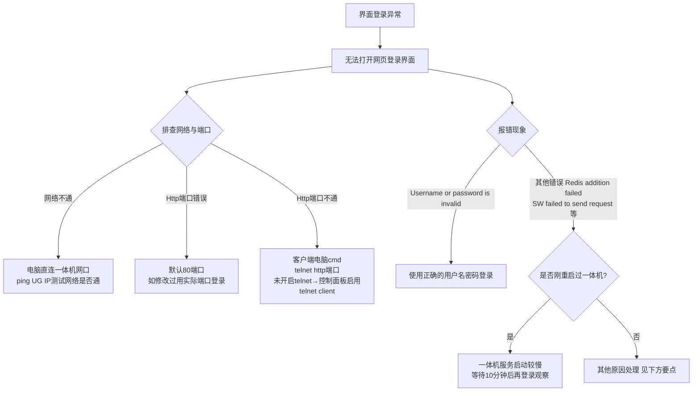

**要点**：
- telnet开启方法：若电脑未开启telnet，请在客户端电脑 `【控制面板 > 程序与功能 > 启用或关闭windows功能】` 中开启 "telnet client"
- 其他原因处理：
  1. 测试使用Eztelent能否开启UG一体机SSH
  2. 如eztelnet无法开启，则电脑以管理器权限运行powershell，然后执行该命令开启：
     ```powershell
     curl -Uri "http://192.168.1.60:23006/openAPI/system/v1/network/SSH/set" -Method Post -ContentType "application/json" -Body (@{ServiceSshdEnable=1} | ConvertTo-Json)
     ```
  3. 若以上方法都无法开启SSH，请提供RS232串口线的远程处理
  4. 若已重启恢复正常，则需收集覆盖问题时间点的UG诊断日志定位（提供出现异常的具体时间点）

---

### 3.3 设备管理类问题

#### 3.3.1 设备离线

**组网**：`IPC/NVR/Smart Box/LPR/解码器/门禁设备/可视对讲 - onvif/private - UG-I500`

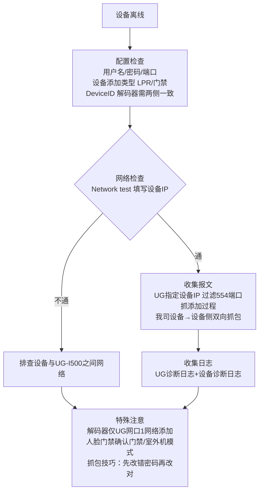

**要点**：
- 特殊注意事项：
  - 解码器：目前仅支持使用UG网口1所在的网络进行添加
  - 人脸门禁：部分人脸门禁支持切换门禁模式或室外机模式，需登录设备侧web确认模式正确
- 抓包注册过程小技巧：可先在UG侧将相机密码/端口修改错误使其离线，然后抓包修改正确使其在线的过程

#### 3.3.2 设备频繁上下线

**组网**：`IPC/NVR/Smart Box/LPR/解码器/门禁设备/可视对讲 - onvif/private - UG-I500`

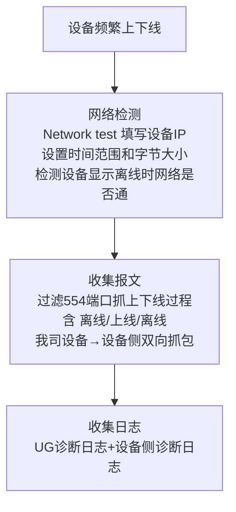

#### 3.3.3 宇视云相关问题

**现象1：宇视云账号离线**
- **组网**：`IPC/NVR/LPR/门禁设备 - 宇视云 - UG-I500`
- **网络**：`【System > Maintenance > Net Detect】`，填写宇视云域名地址，检测网络是否通
- **报文**：UG针对添加云账号的过程抓包（UG过滤554端口抓包）
- **日志**：UG诊断日志

**现象2：宇视云账号在线，云设备在云账号上显示在线，在UG web显示离线**
- **报文**：离线设备和UG同时过滤554端口针对添加云账号的过程抓包（云账号在UG显示在线1分钟后方可停止抓包，提供离线设备的SN号）
- **日志**：离线设备及UG诊断日志
- 不删除云账号的抓包方法：可通过点击"登出/登录"按钮抓包云设备的注册过程
- **报文大小注意**：云设备注册过程的报文可能会超过界面大小限制（100M左右），界面抓完包后确认报文时间是否覆盖添加操作的时间点，并过滤离线设备的SN号（`ip contains "210235C6HN3251000076"`），若时间未包含也过滤不到，则需要ssh到UG一体机后台使用tcpdump命令抓包

**现象3：UG web显示的云设备数量与云账号中的设备数量不一致，缺少部分云设备未同步**
- **报文**：UG过滤554端口针对添加云账号的过程抓包（云账号在UG显示在线1分钟后方可停止抓包，提供缺失设备的SN号）
- **日志**：UG诊断日志
- 不删除云账号的抓包方法同现象2
- **报文大小注意**同现象2，若时间未包含则需要ssh到UG一体机后台使用tcpdump命令抓包

---

### 3.4 实况类问题

#### 3.4.1 卡顿/花屏/黑屏/报错（局域网组网）

**组网1**：`IPC/NVR/SmartBox - private/Onvif - UG-I500 - PC`

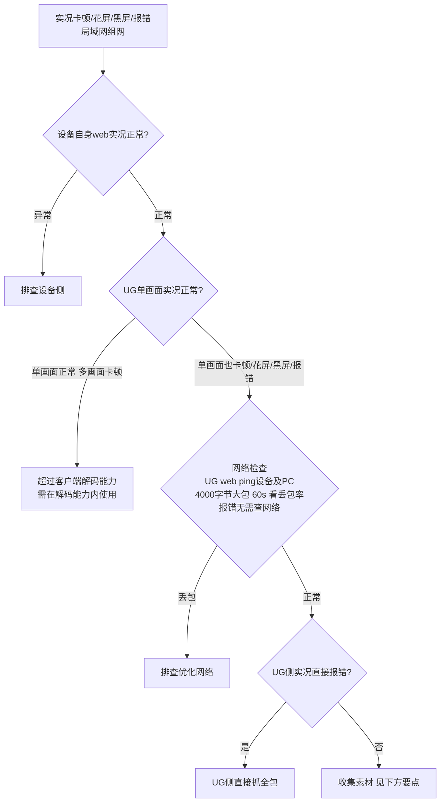

**收集素材要点**：
- **报文**：针对启动相机单画面实况的过程抓包（UG指定设备IP地址及PC IP地址；我司设备则在设备web页面针对UG IP地址抓包；PC同时使用wireshark在实况的电脑上抓包），提供设备、UG、PC IP地址及通道编码
- **日志**：UG与设备侧诊断日志、UG播放器控件日志
- 注：如果UG侧实况直接报错，则UG侧直接抓全包

#### 3.4.2 卡顿/花屏/黑屏/报错（宇视云组网）

**组网2**：`IPC/NVR/SmartBox - 宇视云 - UG-I500 - PC`

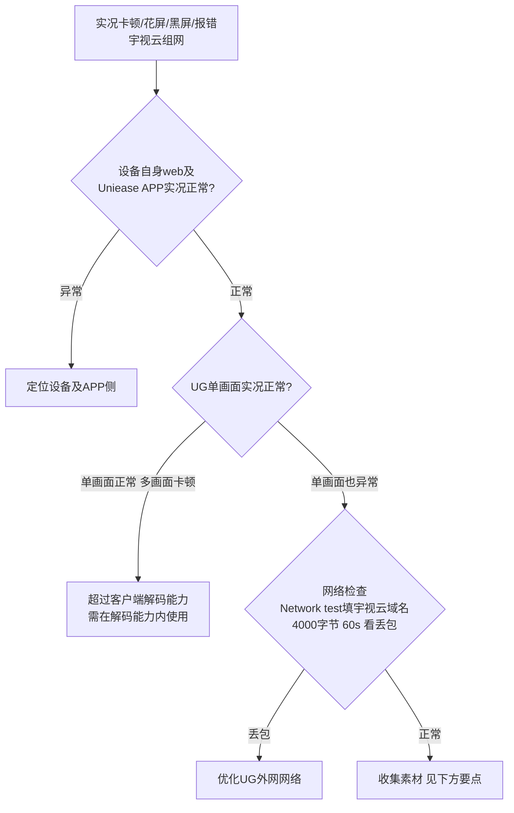

**收集素材要点**：
- **报文**：针对启动相机实况的过程抓包（UG抓全包；我司设备则在设备web页面抓全包；PC同时使用wireshark在实况的电脑上抓包），提供设备SN号及PC IP地址
  - 注：若界面抓包过大未覆盖启动实况的时间点，则需要到ssh到UG一体机后台使用tcpdump命令抓包
- **日志**：UG与设备侧诊断日志、UG播放器控件日志

---

### 3.5 录像回放与下载类问题

#### 3.5.1 回放卡顿/花屏/报错（设备侧录像 - 局域网）

**组网1**：`IPC/NVR（设备侧录像） - Onvif/Private - UG-I500 - PC`

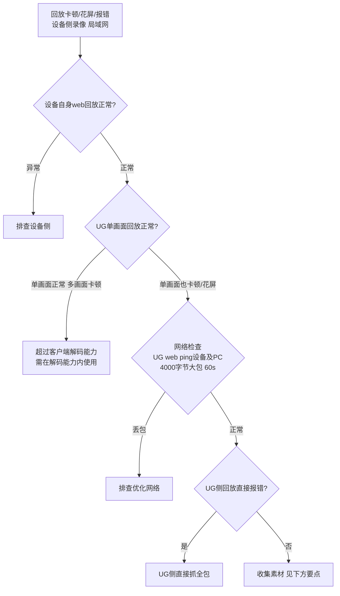

**收集素材要点**：
- **报文**：针对启动相机回放的过程抓包（UG针对设备IP地址抓包；我司设备则在设备web针对UG IP；PC同时使用wireshark在实况的电脑上抓包），提供设备、UG、PC IP地址及通道编码
- **日志**：UG与设备侧诊断日志、UG播放器控件日志

#### 3.5.2 回放卡顿/花屏/报错（设备侧录像 - 宇视云）

**组网2**：`IPC/NVR（设备侧录像） - 宇视云 - UG-I500 - PC`

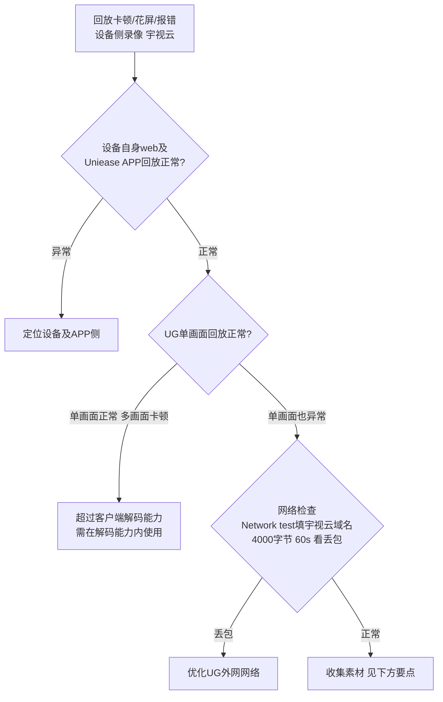

**收集素材要点**：
- **报文**：针对UG启动相机回放的过程抓包（UG与我司设备同时在web抓全包；PC同时使用wireshark在回放的电脑上抓包），提供设备SN号及PC IP地址
  - 注：若界面抓包过大未覆盖启动实况的时间点，则需要到ssh到UG一体机后台使用tcpdump命令抓包
- **日志**：UG与设备侧诊断日志、UG播放器控件日志

#### 3.5.3 回放检索无录像/录像断续（设备侧存储）

**组网1**：`IPC/NVR（录像存储于设备侧） - onvif/private/宇视云 - UG-I500 - PC`

```mermaid
flowchart TD
    A[回放检索无录像/录像断续<br/>设备侧存储] --> B{设备侧与UG系统时间一致?}
    B -->|否| C[修改系统时间一致]
    B -->|是| D{设备侧自身录像正常?}
    D -->|异常| E[排查设备侧录像丢失原因]
    D -->|正常| F{组网类型}
    F -->|局域网| G[UG和设备侧双向抓包<br/>+PC Wireshark抓包<br/>收集设备侧+UG诊断日志]
    F -->|宇视云| H[UG和设备侧双向抓全包<br/>+PC Wireshark抓包<br/>收集设备侧+UG诊断日志<br/>提供设备SN]
    E --> G
    E --> H
```

#### 3.5.4 回放检索无录像/录像断续（UG侧存储）

**组网2**：`IPC/NVR - onvif/private/宇视云 - UG（录像存储于UG侧） - PC`

```mermaid
flowchart TD
    A[回放检索无录像/录像断续<br/>UG侧存储] --> B[配置检查<br/>录像计划正确/设备在线<br/>系统时间正确]
    B --> C{设备与UG间网络}
    C -->|持续波动| D[UG web ping设备IP<br/>4000字节大包 丢包严重排查网络]
    C -->|偶尔波动| E[收集设备+服务器告警日志<br/>设备侧+UG诊断日志<br/>提供录像中断/恢复时间点]
    C -->|正常| F{对应时间段有<br/>视频丢失/上下线告警?}
    F -->|有| G[收集设备侧+UG诊断日志<br/>提供中断/恢复时间点]
    F -->|无| H{存储类型}
    H -->|UG本地硬盘存储| I{检查Local Disk>Recording Storage<br/>本地硬盘识别且状态正常?}
    I -->|硬盘不识别| J[插拔硬盘或交叉测试]
    I -->|识别但状态异常| K[收集UG诊断日志]
    I -->|状态正常| L{多个相机录像异常<br/>重启一个录像计划能否恢复?}
    L -->|能| M[UG诊断日志 含中断时间点<br/>提供各IP及通道编码]
    L -->|不能| N[针对重启录像计划过程UG抓全包<br/>UG诊断日志 提供通道编码]
    H -->|IPSAN存储| O{检查IPSAN management<br/>及IPSAN web阵列状态}
    O -->|阵列异常| P[排查硬盘及阵列]
    O -->|阵列正常 UG状态异常| Q[收集UG诊断日志<br/>IPSAN的cdvsystemreport]
    O -->|均正常| R{多个相机录像异常<br/>重启一个录像计划能否恢复?}
    R -->|能| S[UG诊断日志+cdvsystemreport<br/>含中断时间点 提供通道编码]
    R -->|不能| T[重启录像计划过程UG抓全包<br/>UG诊断日志+对应IPSAN<br/>cdvsystemreport 含中断时间点<br/>提供各IP及通道编码]
    O --> U[IPSAN网络排查<br/>SSH进入IPSAN后台<br/>ping设备IP 20000大包<br/>丢包严重排查网络<br/>无丢包则收集UG+IPSAN<br/>诊断日志+cdvsystemreport<br/>提供中断恢复时间点及通道编码]
```

> **注意**：
> 1. 优先保证相机实况正常，否则先排查实况问题
> 2. 在IPSAN阵列显示正常，但UG web显示状态异常的情况下，优先提供远程处理

#### 3.5.5 录像下载异常

**组网**：`IPC/NVR - onvif/private/宇视云 - UG - PC`

```mermaid
flowchart TD
    A[录像下载异常] --> B{录像回放正常?}
    B -->|异常| C[按录像回放方法排查]
    B -->|正常| D{录像存储位置}
    D -->|设备侧| E[UG web ping设备IP 4000字节大包<br/>PC长ping UG 20000大包]
    D -->|UG本地硬盘| F[PC ping UG 20000大包]
    D -->|IPSAN| G[PC长ping UG 20000大包<br/>UG web ping IPSAN 4000字节大包]
    E --> H{下载过程大量丢包/网络中断?}
    F --> H
    G --> H
    H -->|是| I[优化对应丢包环节的网络]
    H -->|否| J{录像存储位置}
    J -->|设备侧 局域网| K[UG抓PC及设备地址 设备抓UG IP<br/>PC wireshark抓包<br/>收集UG+设备诊断日志+播放器控件日志]
    J -->|设备侧 宇视云| L[UG抓全包+PC wireshark抓包<br/>收集UG+设备诊断日志+播放器控件日志]
    J -->|UG本地硬盘| M[UG抓全包+PC wireshark抓包<br/>收集UG+播放器控件日志]
    J -->|IPSAN| N[UG抓全包+PC wireshark抓包<br/>收集UG+IPSAN诊断日志<br/>播放器控件日志+cdvsystemreport]
```

---

### 3.6 报警类问题

#### 3.6.1 无法收到设备告警

**组网**：`IPC/NVR/smartBox/LPR/门禁 - onvif/private/宇视云 - UG - PC`

```mermaid
flowchart TD
    A[无法收到设备告警] --> B{历史告警能否查询?}
    B -->|不能| C[排查设备侧 见下方要点]
    B -->|能 实时告警无法显示| D{设备自身能否查到告警?}
    D -->|不能| C
    D -->|能| E{PC防火墙关闭?}
    E -->|否| F[关闭防火墙]
    E -->|是| G{告警类型}
    G -->|普通告警<br/>动检/区域入侵/非法停车| H[UG与PC针对对方IP双向抓包<br/>告警传输过程<br/>收集UG诊断日志]
    G -->|布控告警<br/>人脸/车牌| I[确认布控任务从UG侧下发<br/>UG与PC双向抓包过滤554<br/>收集UG诊断日志]
    C --> J[抓包：UG与设备双向抓包过滤554<br/>抓设备注册+告警传输过程<br/>日志：设备+UG诊断日志<br/>抓包技巧：先改错再改对看告警订阅]
    H --> K[配置检查 见下方要点]
    I --> K
```

**要点**：
- 布控告警：人脸库/车牌库、人脸布控任务/车牌任务是否从UG侧下发，若非则需要设备侧删除库与布控任务，由UG侧重新下发
- 抓包注册过程可以先在UG修改端口/密码错误，然后抓修改正确过程的包（注册过程主要看告警订阅情况）
- 配置检查：
  - 检测设备添加类型是否正确
  - 是否有配置图片用途的磁盘（存储告警图片）
  - 是否有做告警订阅（admin默认显示所有告警，但如果做了告警订阅，只显示已订阅的告警）

---

### 3.7 界面操作报错类问题

```mermaid
flowchart TD
    A[界面操作报错] --> B{确认报错现象}
    B -->|规格类报错<br/>如报错超过某最大限制| C[规格限制 请在规格内使用]
    B -->|其他类型报错| D[抓包：UG过滤554端口<br/>抓报错过程的全包<br/>日志：UG诊断日志]
```

---

## 四、UNV Guard

### 4.1 日志与报文收集方法

#### 4.1.1 UG诊断日志

- **导出路径**：进入 `【Operations & Maintenance > System Diagnosis > Server Diagnostic Info】`，选择Server及Server Time，点击 "Generate" 生成并导出日志
- **播放器控件日志**：记录媒体信息（实况、回放等），默认路径：客户端电脑 `C:\Surveillance\UPlayer_x64\log`

#### 4.1.2 IPSAN日志

**IPSAN诊断日志**：
- 登录IPSAN Web页面 `【Log > Diagnosis Log】` 界面，选择时间段，点击 "Export" 即可导出

**IPSAN的cdvsystemreport（UG配套软件的日志）**：
- SSH进入IPSAN后台（端口7777）
- 执行 `systemreport.sh vm /root` 命令收集
- 收集完后日志在 `/root` 目录下

#### 4.1.3 Windows应用及系统日志

部分UNV Guard服务异常问题、web登录异常等问题需要收集UNV Guard所安装server的windows应用系统日志定位。

**收集方法**：
1. 按下 `Win + R` 键，输入 `eventvwr.msc` 然后回车
2. 分别导出 "Application" 与 "System" 日志

#### 4.1.4 普通抓包

**方法1：UNV Guard web页面收集抓包（推荐）**
- 路径：UG web -> `【System Diagnosis】 -> 【Server Packet Capture】`
- 支持指定/过滤端口及IP抓包

**方法2：wireshark抓包**
- 在UG所安装的电脑/服务器打开wireshark
- 进入 `【Capture -> Options】`，选择电脑的回环网卡（loopback）和业务网卡（不清楚哪张可cmd执行 `ipconfig` 查看）
- 注：部分电脑同时抓多个网卡可能会出现抓不到的情况，此时可同时打开两个wireshark窗口，分别指定一个网卡抓包

#### 4.1.5 背景抓包（偶现/长时间复现问题）

- UG服务器抓包界面默认只显示"普通抓包"
- 可通过快捷键 `Ctrl+Alt+Shift+B` 显示"背景抓包"
- 单击 `<新增任务>`，设置抓包条件：背景抓包需设置抓包时长，其他参数说明同"普通抓包"
- 单击 `<新增>` 创建抓包任务，然后单击开始按钮，任务状态为"进行中"
- 当已复现问题但是还未到抓拍时长时，可单击停止按钮手动停止抓包
- 到达抓包时长后自动停止抓包，停止后任务状态显示"打包中"，状态更新为"完成"时，即可进入系统后台路径（界面的Save to所显示路径）下载背景抓包文件

---

### 4.2 界面登录异常

```mermaid
flowchart TD
    A[界面登录异常] --> B[无法打开网页登录界面]
    B --> C{排查网络与端口}
    C -->|网络不通| D[客户端电脑cmd<br/>ping UG Server IP测试网络是否通]
    C -->|Http端口错误| E[默认80/81端口<br/>webshotcut图标确认<br/>如修改过用实际端口登录]
    C -->|Http端口不通| F[客户端电脑cmd<br/>telnet http端口<br/>未开启telnet→控制面板启用telnet client]
    B --> G{报错现象}
    G -->|Username or password is invalid| H[使用正确的用户名密码登录]
    G -->|其他错误 Redis addition failed<br/>SW failed to send request 等| I{UG服务IP与server<br/>网卡地址一致?}
    I -->|不一致| J[查看fusevm_cfg.yaml的PodIP<br/>Change IP Address修改服务IP]
    I -->|一致| K{端口冲突或安全软件?}
    K -->|是| L[Env Diagbosis Tool检测<br/>关闭冲突软件<br/>杀软加入白名单或卸载]
    K -->|否| M[其他原因 见下方要点]
```

**要点**：
- telnet开启方法：若电脑未开启telnet，请在客户端电脑 `【控制面板 > 程序与功能 > 启用或关闭windows功能】` 中开启 "telnet client"
- **UG服务IP查看方法**：进入UG server安装目录 `UNV Guard\Server\framework\VM\vm_fuse\conf`，打开 `fusevm_cfg.yaml` 文件，PodIP为UG服务IP
- **UG服务IP修改方法**：
  1. UG Server桌面，双击 "View UNV Guard Service Status" 图标
  2. 在该界面点击 "Change IP Address"
  3. 选择正确网卡IP，点击修改等待服务重启完即可
- **端口冲突或安全软件检测**：UG Server web登录首页的download center中下载 "Env Diagbosis Tool"，安装后运行该工具检测是否存在端口冲突或杀毒软件；若存在第三方安全/杀毒软件，请与客户沟通将UG所安装目录加入白名单或卸载安全软件
- **其他原因**：
  1. 建议直接提供UG Server的远程环境定位
  2. 若已重启恢复正常，则需收集覆盖问题时间点的UG诊断日志、UG server的windows应用及系统日志定位（提供出现异常的具体时间点）

---

### 4.3 设备管理类问题

#### 4.3.1 设备离线

**组网**：`IPC/NVR/Smart Box/LPR/解码器/门禁设备/可视对讲 - onvif/private - UNV Guard`

```mermaid
flowchart TD
    A[设备离线] --> B[配置检查<br/>用户名/密码/端口<br/>设备添加类型 LPR/门禁<br/>DeviceID 解码器需两侧一致]
    B --> C[磁盘空间检查<br/>UG所安装磁盘剩余空间<br/>少于15%→设备状态异常]
    C -->|空间不足| D[清理空间后重启UG服务<br/>图片容量占用过多→<br/>远程联系二线缩容]
    C -->|空间充足| E{网络检查<br/>Network test 填写设备IP}
    E -->|不通| F[排查设备与UNV Guard之间网络]
    E -->|通| G[收集报文<br/>UG指定设备IP 过滤554端口<br/>抓添加过程<br/>我司设备→设备侧双向抓包]
    G --> H[收集日志<br/>UG诊断日志+设备诊断日志]
    F --> I
    H --> I[特殊注意<br/>解码器仅UG服务IP网口网络添加<br/>人脸门禁确认门禁/室外机模式<br/>抓包技巧：先改错密码再改对]
```

**要点**：
- 磁盘空间检查：UG所安装的磁盘剩余空间少于15%时会导致设备状态异常，需清理空间后重启UG服务恢复正常；若为UG分配的图片容量过多导致占用，需提供远程联系二线缩容
- 特殊注意事项：
  - 解码器：目前仅支持使用UG服务IP所在的网口网络进行添加
  - 人脸门禁：部分人脸门禁支持切换门禁模式或室外机模式，需登录设备侧web确认模式正确
- 抓包注册过程小技巧：可先在UG侧将相机密码/端口修改错误使其离线，然后抓包修改正确使其在线的过程

#### 4.3.2 设备频繁上下线

**组网**：`IPC/NVR/Smart Box/LPR/解码器/门禁设备/可视对讲 - onvif/private - UNV Guard`

```mermaid
flowchart TD
    A[设备频繁上下线] --> B[网络检测<br/>Network test 填写设备IP<br/>设置时间范围和字节大小<br/>检测设备显示离线时网络是否通]
    B --> C[收集报文<br/>过滤554端口抓上下线过程<br/>含 离线/上线/离线<br/>我司设备→设备侧双向抓包]
    C --> D[收集日志<br/>UG诊断日志+设备侧诊断日志]
```

#### 4.3.3 宇视云相关问题

**现象1：宇视云账号离线**
- **组网**：`IPC/NVR/LPR/门禁设备 - 宇视云 - UNV Guard`
- **网络**：`【System > Maintenance > Net Detect】`，填写宇视云域名地址，检测网络是否通
- **报文**：UG针对添加云账号的过程抓包（UG过滤554端口抓包）
- **日志**：UG诊断日志

**现象2：宇视云账号在线，云设备在云账号上显示在线，在UG web显示离线**
- **报文**：离线设备和UG同时过滤554端口针对添加云账号的过程抓包（云账号在UG显示在线1分钟后方可停止抓包，提供离线设备的SN号）
- **日志**：离线设备及UG诊断日志
- 不删除云账号的抓包方法：可通过点击"登出/登录"按钮抓包云设备的注册过程
- **报文大小注意**：云设备注册过程的报文可能会超过界面大小限制（100M左右），界面抓完包后确认报文时间是否覆盖添加操作的时间点，并过滤离线设备的SN号（`ip contains "210235C6HN3251000076"`），若时间未包含也过滤不到，则需要到UG所在服务器使用wireshark抓包

**现象3：UG web显示的云设备数量与云账号中的设备数量不一致，缺少部分云设备未同步**
- **报文**：UG过滤554端口针对添加云账号的过程抓包（云账号在UG显示在线1分钟后方可停止抓包，提供缺失设备的SN号）
- **日志**：UG诊断日志
- 不删除云账号的抓包方法同现象2
- **报文大小注意**同现象2，若时间未包含则需要到UG所在服务器使用wireshark抓包

---

### 4.4 实况类问题

#### 4.4.1 卡顿/花屏/黑屏/报错（局域网组网）

**组网1**：`IPC/NVR/SmartBox - private/Onvif - UNV Guard - PC`

```mermaid
flowchart TD
    A[实况卡顿/花屏/黑屏/报错<br/>局域网组网] --> B{设备自身web实况正常?}
    B -->|异常| C[排查设备侧]
    B -->|正常| D{UG单画面实况正常?}
    D -->|单画面正常 多画面卡顿| E[超过客户端解码能力<br/>需在解码能力内使用]
    D -->|单画面也卡顿/花屏/黑屏/报错| F{网络检查<br/>UG web ping设备及PC<br/>4000字节大包 60s 看丢包率<br/>报错无需查网络}
    F -->|丢包| G[排查优化网络]
    F -->|正常| H{UG侧实况直接报错?}
    H -->|是| I[UG侧直接抓全包]
    H -->|否| J[收集素材 见下方要点]
```

**收集素材要点**：
- **报文**：针对启动相机单画面实况的过程抓包（UG指定设备IP地址及PC IP地址；我司设备则在设备web页面针对UG IP地址抓包；PC同时使用wireshark在实况的电脑上抓包），提供设备、UG、PC IP地址及通道编码
- **日志**：UG与设备侧诊断日志、UG播放器控件日志
- 注：如果UG侧实况直接报错，则UG侧直接抓全包

#### 4.4.2 卡顿/花屏/黑屏/报错（宇视云组网）

**组网2**：`IPC/NVR/SmartBox - 宇视云 - UNV Guard - PC`

```mermaid
flowchart TD
    A[实况卡顿/花屏/黑屏/报错<br/>宇视云组网] --> B{设备自身web及<br/>Uniease APP实况正常?}
    B -->|异常| C[定位设备及APP侧]
    B -->|正常| D{UG单画面实况正常?}
    D -->|单画面正常 多画面卡顿| E[超过客户端解码能力<br/>需在解码能力内使用]
    D -->|单画面也异常| F{网络检查<br/>Network test填宇视云域名<br/>4000字节 60s 看丢包}
    F -->|丢包| G[优化UG外网网络]
    F -->|正常| H[收集素材 见下方要点]
```

**收集素材要点**：
- **报文**：针对启动相机实况的过程抓包（UG抓全包；我司设备则在设备web页面抓全包；PC同时使用wireshark在实况的电脑上抓包），提供设备SN号及PC IP地址
  - 注：若界面抓包过大未覆盖启动实况的时间点，则需在UG所安装server使用wireshark抓包
- **日志**：UG与设备侧诊断日志、UG播放器控件日志

---

### 4.5 录像回放与下载类问题

#### 4.5.1 回放卡顿/花屏/报错（设备侧录像 - 局域网）

**组网1**：`IPC/NVR（设备侧录像） - Onvif/Private - UNV Guard - PC`

```mermaid
flowchart TD
    A[回放卡顿/花屏/报错<br/>设备侧录像 局域网] --> B{设备自身web回放正常?}
    B -->|异常| C[排查设备侧]
    B -->|正常| D{UG单画面回放正常?}
    D -->|单画面正常 多画面卡顿| E[超过客户端解码能力<br/>需在解码能力内使用]
    D -->|单画面也卡顿/花屏| F{网络检查<br/>UG web ping设备及PC<br/>4000字节大包 60s}
    F -->|丢包| G[排查优化网络]
    F -->|正常| H{UG侧回放直接报错?}
    H -->|是| I[UG侧直接抓全包]
    H -->|否| J[收集素材 见下方要点]
```

**收集素材要点**：
- **报文**：针对启动相机回放的过程抓包（UG针对设备IP地址抓包；我司设备则在设备web针对UG IP；PC同时使用wireshark在实况的电脑上抓包），提供设备、UG、PC IP地址及通道编码
- **日志**：UG与设备侧诊断日志、UG播放器控件日志

#### 4.5.2 回放卡顿/花屏/报错（设备侧录像 - 宇视云）

**组网2**：`IPC/NVR（设备侧录像） - 宇视云 - UNV Guard - PC`

```mermaid
flowchart TD
    A[回放卡顿/花屏/报错<br/>设备侧录像 宇视云] --> B{设备自身web及<br/>Uniease APP回放正常?}
    B -->|异常| C[定位设备及APP侧]
    B -->|正常| D{UG单画面回放正常?}
    D -->|单画面正常 多画面卡顿| E[超过客户端解码能力<br/>需在解码能力内使用]
    D -->|单画面也异常| F{网络检查<br/>Network test填宇视云域名<br/>4000字节 60s 看丢包}
    F -->|丢包| G[优化UG外网网络]
    F -->|正常| H[收集素材 见下方要点]
```

**收集素材要点**：
- **报文**：针对UG启动相机回放的过程抓包（UG与我司设备同时在web抓全包；PC同时使用wireshark在回放的电脑上抓包），提供设备SN号及PC IP地址
  - 注：若界面抓包过大未覆盖启动实况的时间点，则需在UG所安装server使用wireshark抓包
- **日志**：UG与设备侧诊断日志、UG播放器控件日志

#### 4.5.3 回放检索无录像/录像断续（设备侧存储）

**组网1**：`IPC/NVR（录像存储于设备侧） - onvif/private/宇视云 - UNV Guard - PC`

```mermaid
flowchart TD
    A[回放检索无录像/录像断续<br/>设备侧存储] --> B{设备侧与UG系统时间一致?}
    B -->|否| C[修改系统时间一致]
    B -->|是| D{设备侧自身录像正常?}
    D -->|异常| E[排查设备侧录像丢失原因]
    D -->|正常| F{组网类型}
    F -->|局域网| G[UG和设备侧双向抓包<br/>+PC Wireshark抓包<br/>收集设备侧+UG诊断日志]
    F -->|宇视云| H[UG和设备侧双向抓全包<br/>+PC Wireshark抓包<br/>收集设备侧+UG诊断日志<br/>提供设备SN]
    E --> G
    E --> H
```

#### 4.5.4 回放检索无录像/录像断续（UG侧存储）

**组网2**：`IPC/NVR - onvif/private/宇视云 - UG（录像存储于UG侧） - PC`

```mermaid
flowchart TD
    A[回放检索无录像/录像断续<br/>UG侧存储] --> B[配置检查<br/>录像计划正确/设备在线<br/>系统时间正确]
    B --> C{设备与UG间网络}
    C -->|持续波动| D[UG web ping设备IP<br/>4000字节大包 丢包严重排查网络]
    C -->|偶尔波动| E[收集设备+服务器告警日志<br/>设备侧+UG诊断日志<br/>提供录像中断/恢复时间点]
    C -->|正常| F{对应时间段有<br/>视频丢失/上下线告警?}
    F -->|有| G[收集设备侧+UG诊断日志<br/>提供中断/恢复时间点]
    F -->|无| H{存储类型}
    H -->|UG本地硬盘存储| I{检查Local Disk>Recording Storage<br/>及server计算机管理<br/>本地硬盘识别且状态正常?}
    I -->|Server不识别| J[插拔硬盘或交叉测试]
    I -->|Server正常 web状态异常| K[收集UG诊断日志]
    I -->|状态均正常| L{多个相机录像异常<br/>重启一个录像计划能否恢复?}
    L -->|能| M[UG诊断日志 含中断时间点<br/>提供各IP及通道编码]
    L -->|不能| N[针对重启录像计划过程UG抓全包<br/>UG诊断日志 提供通道编码]
    H -->|IPSAN存储| O{检查IPSAN management<br/>及IPSAN web阵列状态}
    O -->|阵列异常| P[排查硬盘及阵列]
    O -->|阵列正常 UG状态异常| Q[收集UG诊断日志<br/>IPSAN的cdvsystemreport]
    O -->|均正常| R{多个相机录像异常<br/>重启一个录像计划能否恢复?}
    R -->|能| S[UG诊断日志+cdvsystemreport<br/>含中断时间点 提供通道编码]
    R -->|不能| T[重启录像计划过程UG抓全包<br/>UG诊断日志+对应IPSAN<br/>cdvsystemreport 含中断时间点<br/>提供各IP及通道编码]
    O --> U[IPSAN网络排查<br/>SSH进入IPSAN后台<br/>ping设备IP 20000大包<br/>丢包严重排查网络<br/>无丢包则收集UG+IPSAN<br/>诊断日志+cdvsystemreport<br/>提供中断恢复时间点及通道编码]
```

> **注意**：
> 1. 优先保证相机实况正常，否则先排查实况问题
> 2. 在IPSAN阵列显示正常，但UG web显示状态异常的情况下，优先提供远程处理

#### 4.5.5 录像下载异常

**组网**：`IPC/NVR - onvif/private/宇视云 - UG - PC`

```mermaid
flowchart TD
    A[录像下载异常] --> B{录像回放正常?}
    B -->|异常| C[按录像回放方法排查]
    B -->|正常| D{录像存储位置}
    D -->|设备侧| E[UG web ping设备IP 4000字节大包<br/>PC长ping UG 20000大包]
    D -->|UG本地硬盘| F[PC ping UG 20000大包]
    D -->|IPSAN| G[PC长ping UG 20000大包<br/>UG web ping IPSAN 4000字节大包]
    E --> H{下载过程大量丢包/网络中断?}
    F --> H
    G --> H
    H -->|是| I[优化对应丢包环节的网络]
    H -->|否| J{录像存储位置}
    J -->|设备侧 局域网| K[UG抓PC及设备地址 设备抓UG IP<br/>PC wireshark抓包<br/>收集UG+设备诊断日志+播放器控件日志]
    J -->|设备侧 宇视云| L[UG抓全包+PC wireshark抓包<br/>收集UG+设备诊断日志+播放器控件日志]
    J -->|UG本地硬盘| M[UG抓全包+PC wireshark抓包<br/>收集UG+播放器控件日志]
    J -->|IPSAN| N[UG抓全包+PC wireshark抓包<br/>收集UG+IPSAN诊断日志<br/>播放器控件日志+cdvsystemreport]
```

---

### 4.6 报警类问题

#### 4.6.1 无法收到设备告警

**组网**：`IPC/NVR/smartBox/LPR/门禁 - onvif/private/宇视云 - UG - PC`

```mermaid
flowchart TD
    A[无法收到设备告警] --> B{历史告警能否查询?}
    B -->|不能| C[排查设备侧 见下方要点]
    B -->|能 实时告警无法显示| D{设备自身能否查到告警?}
    D -->|不能| C
    D -->|能| E{PC防火墙关闭?}
    E -->|否| F[关闭防火墙]
    E -->|是| G{告警类型}
    G -->|普通告警<br/>动检/区域入侵/非法停车| H[UG与PC针对对方IP双向抓包<br/>告警传输过程<br/>收集UG诊断日志]
    G -->|布控告警<br/>人脸/车牌| I[确认布控任务从UG侧下发<br/>UG与PC双向抓包过滤554<br/>收集UG诊断日志]
    C --> J[抓包：UG与设备双向抓包过滤554<br/>抓设备注册+告警传输过程<br/>日志：设备+UG诊断日志<br/>抓包技巧：先改错再改对看告警订阅]
    H --> K{磁盘空间检查<br/>UG所安装磁盘剩余空间<br/>少于15%→告警接收异常}
    I --> K
    K -->|空间不足| L[清理空间后重启UG服务<br/>图片容量占用过多→<br/>远程联系二线缩容]
    K -->|空间充足| M[配置检查 见下方要点]
```

**要点**：
- 布控告警：人脸库/车牌库、人脸布控任务/车牌任务是否从UG侧下发，若非则需要设备侧删除库与布控任务，由UG侧重新下发
- 磁盘空间检查：UG所安装的磁盘剩余空间少于15%时会导致告警接收异常，需清理空间后重启UG服务恢复正常；若为UG分配的图片容量过多导致占用，需提供远程联系二线缩容
- 抓包注册过程可以先在UG修改端口/密码错误，然后抓修改正确过程的包（注册过程主要看告警订阅情况）
- 配置检查：
  - 检测设备添加类型是否正确
  - 是否有配置图片用途的磁盘（存储告警图片）
  - 是否有做告警订阅（admin默认显示所有告警，但如果做了告警订阅，只显示已订阅的告警）

---

### 4.7 界面操作报错类问题

```mermaid
flowchart TD
    A[界面操作报错] --> B{确认报错现象}
    B -->|规格类报错<br/>如报错超过某最大限制| C[规格限制 请在规格内使用]
    B -->|其他类型报错| D[抓包：UG过滤554端口<br/>抓报错过程的全包<br/>日志：UG诊断日志]
```

---

> 本文档基于VMS（Unicorn）V2026、UG-I500 V2026、UNV Guard V2026版本培训材料整理，如有版本更新请以最新官方文档为准。

